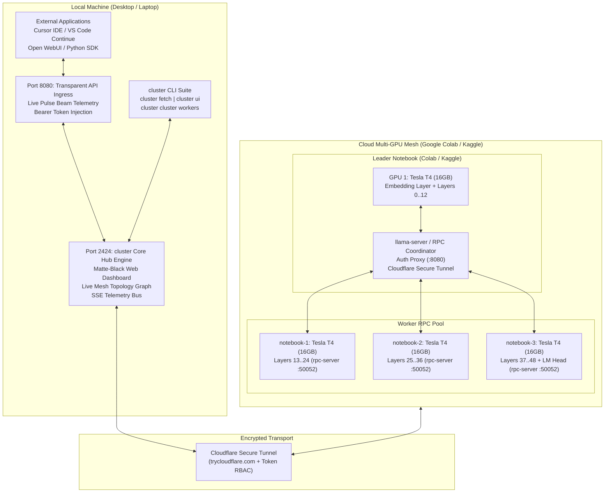

# cluster
## Multi-Notebook Distributed GPU Mesh

Pool multiple ephemeral cloud notebooks (Google Colab, Kaggle, team GPU instances) into an orchestrated, unified multi-GPU inference cluster, accessible via both a streamlined CLI and a sleek, Cortex.io-style matte-black desktop web dashboard.

[](https://colab.research.google.com/github/berlin-566/cluster/blob/main/notebooks/colab_cluster.ipynb)
[](LICENSE)
[](https://www.python.org/downloads/)

---

## Key Features

* **Unified Multi-GPU Model Deployment**: Download a model once (Qwen 2.5 14B/32B/72B, DeepSeek-R1, GLM, Llama 3.3) and cooperatively deploy across 4+ GPUs simultaneously.
* **VRAM Pooling**: Combines the VRAM of all participating notebooks (e.g. 4x 16GB T4 = **64GB pooled VRAM**, or 4x 2xT4 = **128GB pooled VRAM**) to run massive models that cannot fit on any single notebook.
* **Pre-Compiled llama.cpp RPC Backends**: High-performance CUDA 12 RPC engine (`llama-server` and `rpc-server`) with zero Python runtime overhead during token generation.
* **Interactive Multi-Provider Model Resolver (`cluster fetch <model>`)**: Searches across Ollama Library and Hugging Face Hub (verified GGUF publishers), displays quantization levels and automatic pooled VRAM fit evaluation before deploying.
* **Dual-Port Runtime Architecture**:
  * **Port 2424**: Core Hub Engine and Cortex.io-style Matte-Black Web Dashboard.
  * **Port 8080**: Transparent API Proxy ingress; all client tools (Cursor, VS Code, Open WebUI) connect to 8080, which routes through the 2424 Hub for live traffic telemetry and mesh visualization.
* **Zero-Dependency Embedded Frontend**: 100% self-contained HTML5, modern CSS, reactive JS, and vector SVGs bundled directly into the Python package with zero Node.js/npm requirements (under 25MB RAM).
* **Automatic UI Launch**: Running `cluster ui` boots the 2424 Hub, binds the 8080 proxy, and automatically opens your default browser.
* **Dual-Mode Persona Experience**:
  * **Admin Mode**: Full cluster management, model deployment, layer sharding orchestration, worker eviction, and diagnostic logs.
  * **User / Member Mode**: Built-in interactive streaming chat playground, local proxy status (`http://127.0.0.1:8080`), and live generation speed scoreboard.
* **Resilient Hot-Reconnection**: If a worker notebook disconnects due to Colab idle timeout, prompts are paused in queue while the Leader alerts with the exact one-liner command to rejoin without restarting the cluster.

---

## Architecture



---

## Quickstart

### 1. Launch the Leader Notebook
1. Open the Leader Notebook: [](https://colab.research.google.com/github/berlin-566/cluster/blob/main/notebooks/colab_cluster.ipynb)
2. Switch Runtime to **T4 GPU** (or 2x T4 on Kaggle).
3. Run the bootstrap cell and enter the number of worker notebooks (default: 3).
4. The Leader control board will output:
   * **Worker Join Links**: Copy-paste into secondary blank Colab/Kaggle notebooks.
   * **Admin Link**: `cluster admin connect <url> --token <token>`
   * **Member Link**: `cluster connect <url> --token <token>`

### 2. Install or Update cluster Desktop CLI
```bash
curl -fsSL https://raw.githubusercontent.com/berlin-566/cluster/main/desktop.sh | bash
```

### 3. Connect & Launch Dashboard
```bash
# Connect as Administrator
cluster admin connect <leader-tunnel-url> --token <admin-token>

# Launch the Cortex.io-style Matte-Black Desktop Web Dashboard
cluster ui
```
The browser will automatically open `http://localhost:2424`.

---

## CLI Reference

### Admin Commands
```bash
# Authenticate as cluster administrator
cluster admin connect <url> --token <token>

# Interactive multi-provider model search and cooperative deployment
cluster fetch <query>

# Live multi-node GPU dashboard with pooled VRAM telemetry
cluster gpu

# Comprehensive cluster health and latency report
cluster cluster status

# List worker node states and reconnect commands
cluster cluster workers

# Launch local Hub and open the browser dashboard on http://localhost:2424
cluster ui [--port 2424] [--proxy-port 8080] [--no-browser]
```

### Team Member Commands
```bash
# Authenticate as team member
cluster connect <url> --token <token>

# Interactive terminal chat streaming at multi-GPU speed
cluster chat [model]

# Local transparent reverse proxy for Cursor, VS Code, and Open WebUI
cluster proxy [--port 8080]

# Check cluster connectivity and current loaded model
cluster status

# Check installed version and live update status against main branch
cluster version
```

---

## Transparent Proxy IDE Setup (Port 8080)

All external tools connect to `http://127.0.0.1:8080`:

* **Cursor IDE**:
  * Settings -> Models -> Add Custom Model -> Model: `qwen2.5:14b` (or active model)
  * OpenAI API Key: `cluster`
  * Override Base URL: `http://127.0.0.1:8080/v1`
* **Python OpenAI SDK**:
  ```python
  from openai import OpenAI
  client = OpenAI(base_url="http://127.0.0.1:8080/v1", api_key="cluster")
  response = client.chat.completions.create(
      model="qwen2.5:14b",
      messages=[{"role": "user", "content": "Explain quantum computing in one sentence."}],
      stream=True
  )
  for chunk in response:
      print(chunk.choices[0].delta.content or "", end="")
  ```

---

## License

MIT License. Designed with zero bloat and strictly vector SVG iconography.
