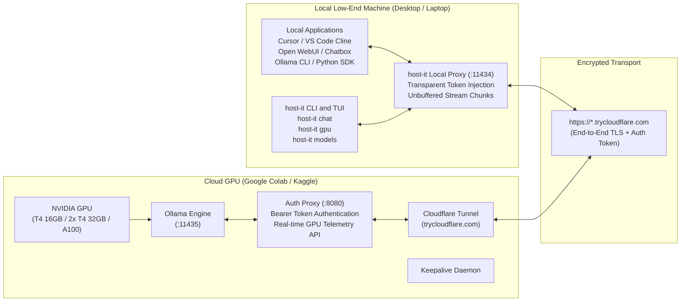

# host-it
## Cloud-to-Local LLM Bridge

Run powerful open-weight models (DeepSeek-R1, Qwen 2.5 14B/32B, Llama 3.3 70B) on free cloud GPUs (Google Colab, Kaggle) and access them seamlessly on your low-end laptop.

[](https://colab.research.google.com/github/berlin-566/host-it/blob/main/notebooks/colab_host_it.ipynb)
[](LICENSE)
[](https://www.python.org/downloads/)

## The Problem and The Solution

* The Problem: You want to experiment with or develop apps using large, strong LLMs like DeepSeek-R1 14B/32B, Qwen 2.5 14B/32B, or Llama 3.3 70B. But your local desktop or laptop has limited RAM/VRAM, leading to out-of-memory errors or slow speeds.
* The Solution: host-it spins up an Ollama engine on free cloud GPUs (Google Colab T4/A100 or Kaggle 2x T4 = 32GB VRAM), locks it down behind an authenticated reverse proxy, tunnels it securely over Cloudflare, and binds a transparent bridge locally to http://127.0.0.1:11434.

Any tool that works with Ollama, including Cursor, VS Code Continue, Open WebUI, Chatbox, AnythingLLM, or the official ollama CLI, now runs at full cloud GPU speed directly from your laptop.

## Architecture



## Quickstart

### Step 1: Start the Cloud Host (Colab or Kaggle)

#### Option A: Google Colab (1-Click)
1. Open the notebook: [](https://colab.research.google.com/github/berlin-566/host-it/blob/main/notebooks/colab_host_it.ipynb)
2. Ensure GPU is enabled: Runtime -> Change runtime type -> T4 GPU.
3. Run the cell (Ctrl+F9).
4. Copy the generated `host-it connect ...` command from the console output.

Optional: Check the PERSIST_TO_GOOGLE_DRIVE checkbox in Colab to keep downloaded models permanently in your Google Drive across sessions.

#### Option B: Kaggle (2x T4 GPUs = 32 GB VRAM)
1. Open a new notebook on Kaggle (https://www.kaggle.com/code).
2. Set Accelerator to GPU T4 x 2 in the right settings panel.
3. Toggle Internet On (requires phone verification on Kaggle).
4. Run:
   ```bash
   !curl -fsSL https://raw.githubusercontent.com/berlin-566/host-it/main/remote/bootstrap.sh | bash
   ```
5. Copy the generated `host-it connect ...` command.

### Step 2: Install host-it Locally

Install the lightweight local CLI:
```bash
git clone https://github.com/berlin-566/host-it.git
cd host-it
pip install -e .
```

Or run without installing using Python:
```bash
python3 -m host_it --help
```

### Step 3: Connect to Cloud Host

Paste the command from your cloud notebook:
```bash
host-it connect https://random-words.trycloudflare.com --token host-it-sec-9a4f2b1c
```
Output:
```text
[OK] Connected successfully! Latency: 42.1 ms
[GPU] Remote GPU: Tesla T4 (VRAM: 0MB / 15360MB)
Next steps:
  1. Start local proxy:  host-it proxy
  2. Chat in terminal:   host-it chat
```

### Step 4: Pull Your First Model and Chat

Download a model directly onto the cloud GPU:
```bash
host-it models pull qwen2.5:14b
# or: host-it models pull deepseek-r1:14b
# or: host-it models pull llama3.1:8b
```

Start the interactive terminal chat:
```bash
host-it chat
```

### Step 5: Start Local Proxy for Apps

Run the local transparent proxy:
```bash
host-it proxy
```
```text
[PROXY] host-it local proxy running at http://127.0.0.1:11434
[INFO] Point Cursor, Continue, Open WebUI, or Ollama CLI to: http://127.0.0.1:11434
```

Now, any app that connects to http://localhost:11434 is backed by your cloud GPU.

## Connecting Local Apps

### Cursor / VS Code (Continue Extension)
In config.json for Continue or Cursor:
```json
{
  "models": [
    {
      "title": "Cloud Qwen 2.5 14B",
      "provider": "ollama",
      "model": "qwen2.5:14b",
      "apiBase": "http://localhost:11434"
    }
  ]
}
```

### Open WebUI
Run Open WebUI via Docker:
```bash
docker run -d -p 3000:8080 --add-host=host.docker.internal:host-gateway -v open-webui:/app/backend/data --name open-webui --restart always ghcr.io/open-webui/open-webui:main
```
Open http://localhost:3000 to interact with models running through host-it.

### Official Ollama CLI and SDK
Use the official ollama CLI as normal:
```bash
ollama list
ollama run qwen2.5:14b "Explain quantum computing simply."
```

Or via Python:
```python
import ollama

client = ollama.Client(host='http://localhost:11434')
response = client.chat(model='qwen2.5:14b', messages=[
    {'role': 'user', 'content': 'Hello from my laptop!'}
])
print(response['message']['content'])
```

## CLI Reference

| Command | Description |
| :-- | :-- |
| host-it connect <url> --token <token> | Connect to a remote cloud runner and save config |
| host-it proxy [--port 11434] | Start the transparent local Ollama reverse proxy |
| host-it chat [model] | Launch interactive terminal chat with live streaming |
| host-it models list | List all models installed on the remote cloud GPU |
| host-it models pull <name> | Download a model directly to the cloud GPU |
| host-it models rm <name> | Delete a model from the cloud GPU |
| host-it gpu | View live remote GPU VRAM usage and temperature |
| host-it status | Check ping latency and tunnel health |
| host-it notebook colab | Print Google Colab 1-click launch instructions |
| host-it notebook kaggle | Print Kaggle 2x T4 setup instructions |

## Security and Privacy

1. Cryptographic Token Gate: Cloudflare Tunnel URLs are protected with a unique Bearer token (host-it-sec-...). Any unauthenticated request from the internet is rejected with 401 Unauthorized.
2. Encrypted in Transit: All communication between your laptop and the cloud GPU uses HTTPS / TLS 1.3 encryption.
3. Zero Open Inbound Ports on Laptop: Your laptop makes outbound connections only; no port forwarding or public router IP exposure needed.

## Testing

Run the test suite:
```bash
python3 -m unittest discover tests -v
```

## License

MIT (c) berlin-566
