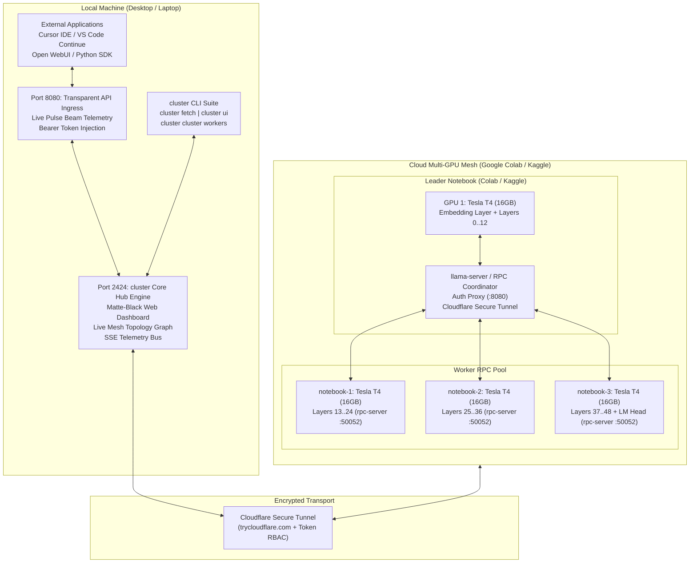

# cluster
## Multi-Notebook Distributed GPU Mesh

Pool multiple ephemeral cloud notebooks (Google Colab, Kaggle, team GPU instances) into an orchestrated, unified multi-GPU inference cluster, accessible via both a streamlined CLI and a sleek, Cortex.io-style matte-black desktop web dashboard.

[](https://colab.research.google.com/github/berlin-566/cluster/blob/main/notebooks/colab_cluster.ipynb)
[](LICENSE)
[](https://www.python.org/downloads/)

## Key Features

* **Unified Multi-GPU Model Deployment**: Download a model once (Qwen 2.5 14B/32B/72B, DeepSeek-R1, GLM, Llama 3.3) and cooperatively deploy across 4+ GPUs simultaneously.
* **VRAM Pooling**: Combines the VRAM of all participating notebooks (e.g. 4x 16GB T4 = **64GB pooled VRAM**, or 4x 2xT4 = **128GB pooled VRAM**) to run massive models that cannot fit on any single notebook.
* **Pre-Compiled llama.cpp RPC Backends**: High-performance CUDA 12 RPC engine (`llama-server` and `rpc-server`) with zero Python runtime overhead during token generation.
* **Interactive Multi-Provider Model Resolver (`cluster fetch <model>`)**: Searches across Ollama Library and Hugging Face Hub (verified GGUF publishers), displays quantization levels and automatic pooled VRAM fit evaluation before deploying.
* **Dual-Port Runtime Architecture**:
  * **Port 2424**: Core Hub Engine, REST API, and Server-Sent Events (SSE) telemetry bus.
  * **Port 8080**: Transparent API Proxy ingress; all client tools (Cursor, VS Code, Open WebUI) connect to 8080, which routes through the 2424 Hub for live traffic telemetry and mesh visualization.
* **Rich Premium Terminal User Interface (TUI)**: Powered by Python **Textual**, `cluster ui` launches a full terminal cockpit featuring:
  * **Hierarchical Card DAG Topology**: Live interactive tree visualizing the Admin manager, Leader coordinator node, 3+ Worker nodes, and connected Team Members.
  * **Interactive Node Inspector Drawer**: Focused node telemetry with instant hotkey actions (`[c]` copy reconnect one-liner, `[r]` ping RPC latency, `[e]` evict).
  * **5-Tab Navigation**: `[1] Mesh Topology`, `[2] Models & Deploy`, `[3] Chat Playground`, `[4] Team & Traffic`, `[5] System Logs`.
  * **Cyber Matte Dark Aesthetic**: Clean Tokyo Night / Slate theme, rounded Unicode borders, and strictly zero emojis.
* **Automatic TUI Launch**: Running `cluster ui` boots the 2424 Hub and 8080 proxy in background threads and launches the full Textual TUI directly in your terminal (use `--web` to launch the browser dashboard).
* **Dual-Mode Persona Experience**:
  * **Admin Mode**: Full cluster management, model deployment, layer sharding orchestration, worker eviction, and diagnostic logs.
  * **User / Member Mode**: Built-in interactive streaming chat playground, local proxy status (`http://127.0.0.1:8080`), and live generation speed scoreboard.
* **Resilient Hot-Reconnection**: If a worker notebook disconnects due to Colab idle timeout, prompts are paused in queue while the Leader alerts with the exact one-liner command to rejoin without restarting the cluster.

## Architecture



## Quickstart

### Step 1: Install cluster on Your Local Machine

Run this single command in your local Linux or macOS terminal:

```bash
curl -fsSL https://raw.githubusercontent.com/berlin-566/cluster/main/desktop.sh | bash
```

### Step 2: Launch Your Cloud Host

> [!NOTE]
> **Status**: Single Notebook Host mode (`single.sh`) is fully optimized, verified, and recommended for immediate use (supports 2x Tesla T4 30GB on Kaggle or T4 on Colab). Multi-notebook cooperative mesh clustering (`cluster.sh` + `worker.sh`) is currently in active development.

Choose between Single Notebook mode or Multi-Notebook Cluster mode:

#### Option A: Single Notebook (Quick 1-GPU Host)

Run in a code cell on Google Colab or Kaggle:

```bash
!curl -fsSL https://raw.githubusercontent.com/berlin-566/cluster/main/single.sh | bash
```

Copy the connection command shown in the notebook output and run it on your local machine:

```bash
cluster connect <tunnel-url> --token <token>
cluster serve
cluster chat
```

#### Option B: Multi-Notebook Cluster (Pooled Multi-GPU Mesh)

Run in a code cell on your primary Leader Google Colab or Kaggle notebook:

```bash
!curl -fsSL https://raw.githubusercontent.com/berlin-566/cluster/main/cluster.sh | bash
```

The Leader notebook will initialize and display the complete control board:

1. **Worker Join Commands**: Run each generated one-liner in secondary blank notebooks:
   ```bash
   !curl -fsSL https://raw.githubusercontent.com/berlin-566/cluster/main/worker.sh | bash -s -- --leader <tunnel-url> --token <worker-token> --name notebook-1
   ```
2. **Admin Command**: Connect from your laptop to manage models and view full cluster telemetry:
   ```bash
   cluster admin connect <leader-tunnel-url> --token <admin-token>
   cluster ui
   ```
   Launches the rich Textual TUI dashboard directly in your terminal (with `--web` flag to open the browser dashboard at `http://localhost:2424`).
3. **Team Member Command**: Share with team members for inference access:
   ```bash
   cluster connect <leader-tunnel-url> --token <member-token>
   ```

## CLI Reference

### Admin Commands

```bash
# Authenticate as cluster administrator
cluster admin connect <url> --token <token>

# Interactive multi-provider model search and cooperative deployment
cluster fetch <query>

# Live multi-node GPU dashboard with pooled VRAM telemetry
cluster gpu

# Comprehensive cluster health and latency report
cluster cluster status

# List worker node states and reconnect commands
cluster cluster workers

# Launch local Hub and open the Textual TUI dashboard (or browser with --web)
cluster ui [--port 2424] [--proxy-port 8080] [--web]
```

### Team Member Commands

```bash
# Authenticate as team member
cluster connect <url> --token <token>

# Interactive terminal chat streaming at multi-GPU speed
cluster chat [model]

# Local transparent API server and Ollama bridge (Cursor, VS Code, Open WebUI, Ollama CLI)
cluster serve [--port 8080]
# Alias: cluster proxy

# Check cluster connectivity and current loaded model
cluster status

# Check installed version and live update status against main branch
cluster version
```

## Transparent Proxy & Ollama Setup (Port 8080 / 11434)

All external tools connect to `http://127.0.0.1:8080`:

* **Native Ollama CLI (`ollama list`, `ollama ps`, `ollama run`)**:
  Running `cluster serve` automatically dual-binds port 11434 (if available) alongside port 8080. You can run standard Ollama CLI commands directly:
  ```bash
  ollama list
  ollama ps
  ollama run qwen2.5:14b
  ```
  If port 11434 is already in use by a local process, point your Ollama CLI to the cluster bridge:
  ```bash
  export OLLAMA_HOST=127.0.0.1:8080
  ollama list
  ```

* **Cursor IDE**:
  * Settings -> Models -> Add model:
  * Model Name: `qwen2.5:14b` (or your deployed model)
  * OpenAI Base URL: `http://localhost:8080/v1`

* **VS Code (Continue Extension)**:
  * Add to `~/.continue/config.json`:
  ```json
  {
    "models": [
      {
        "title": "cluster Multi-GPU",
        "provider": "openai",
        "model": "qwen2.5:14b",
        "apiBase": "http://localhost:8080/v1"
      }
    ]
  }
  ```

* **Open WebUI (Docker)**:
  ```bash
  docker run -d -p 3000:8080 --add-host=host.docker.internal:host-gateway -e OLLAMA_BASE_URL=http://host.docker.internal:8080 -v open-webui:/app/backend/data --name open-webui ghcr.io/open-webui/open-webui:main
  ```

## Security and Privacy

1. **Cryptographic Token Gate**: Cloudflare Tunnel URLs are protected with unique Bearer tokens (`cluster-admin-...`, `cluster-member-...`, `cluster-sec-...`). Any unauthenticated request is rejected with 401 Unauthorized.
2. **Encrypted in Transit**: All communication between your machine and cloud GPUs uses TLS 1.3 encryption.
3. **Zero Inbound Ports on Cloud Notebooks**: Cloud notebooks make outbound connections only over Cloudflare secure tunnels; no static public IP or port forwarding required.

## Testing

Run the automated test suite:
```bash
python3 -m unittest discover tests -v
```

## License

MIT (c) berlin-566
